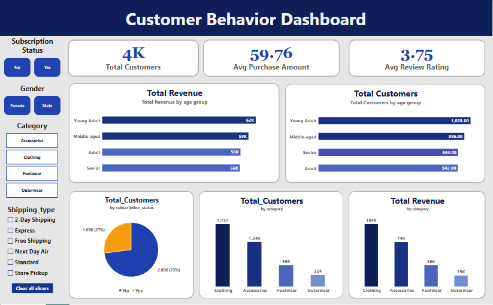

# 🛍️ Customer Shopping Behavior & Analytics Dashboard

An end-to-end data analytics pipeline and interactive business intelligence solution built to analyze retail customer shopping trends, segment buyers, and uncover actionable purchasing insights using Python, Microsoft SQL Server, and Power BI.

---

## 📁 Project Directory Structure

```text
customer-shopping-behavior-analytics/
│
├── assest/                             # Dashboard screenshots and visual assets
│   └── Dashboard.PNG
│
├── Python_Script/                      # Data preprocessing & EDA pipeline
│   └── Customer_Shopping_Behavior_Analysis.ipynb
│
├── Quries/                             # MS SQL Server T-SQL scripts & analytical views
│   └── Customer_DB_Querirs.sql
│
├── Customer_Behaviour_Dashboard.pbix   # Interactive Power BI dashboard file
└── README.md                           # Project documentation
```

---

## 🏗️ Project Workflow & Architecture

### 1. 🐍 Data Preprocessing & Exploratory Data Analysis (Python)

Loaded, explored, and cleaned the raw customer shopping dataset using Python and Pandas.

**Key activities:**
- Loaded and explored the raw dataset using Pandas.
- Handled missing values using a category-based median imputation strategy.
- Performed feature engineering to create `age_group` using `qcut` and `purchase_frequency_days`.
- Removed redundant columns, including `promo_code_used`.
- Standardized column names using the `snake_case` naming convention.
- Loaded the cleaned dataset into Microsoft SQL Server using SQLAlchemy.

**Tools:** Python, Pandas, SQLAlchemy, pyodbc, Jupyter Notebook.

### 2. 🗄️ Database Views & Modeling (Microsoft SQL Server)

Developed custom T-SQL scripts to create reusable analytical views within Microsoft SQL Server.

These views provide a structured analytical layer for business intelligence reporting and simplify complex analytical queries.

**Key activities:**
- Created reusable SQL views for customer behavior analysis.
- Aggregated revenue and purchasing metrics.
- Analyzed customer segments and subscription behavior.
- Used window functions to identify top-performing products by category.
- Examined discount usage and shipping methods.
- Analyzed repeat buyers and age-group revenue.

### 3. 📊 Interactive Dashboard (Power BI)

Connected Power BI directly to the SQL Server database to develop an interactive dashboard for analyzing customer shopping behavior.

**Dashboard features:**
- Interactive slicers for Subscription Status, Gender, Category, and Shipping Type.
- KPI cards displaying key business metrics.
- Revenue analysis across age groups and product categories.
- Customer distribution across different buyer segments.
- Product performance and customer review analysis.
- DAX measures for dynamic calculations and interactive reporting.

---

## 📸 Dashboard Preview



### 📌 Key Dashboard Highlights

**Core KPIs**
- **Total Customers:** Approximately 4K
- **Average Purchase Amount:** $59.76
- **Average Review Rating:** 3.75

**Behavioral Insights**
- Revenue and customer distribution across different age groups.
- Purchasing patterns across product categories.
- Customer segmentation based on purchasing behavior.
- Analysis of subscription status and spending patterns.
- Discount usage and shipping method comparisons.
- Product performance based on customer ratings.

---

## 🗄️ SQL Views Summary

The SQL scripts are available in `Quries/Customer_DB_Querirs.sql`.

| View Name | Description |
|---|---|
| `vw_customer_behavior_base` | Master view containing the main customer attributes. |
| `vw_gender_revenue` | Aggregates total purchase revenue by gender. |
| `vw_discount_above_avg` | Identifies transactions with discounts above the average discount. |
| `vw_top_items_by_rating` | Ranks top-performing items based on customer review ratings. |
| `vw_shipping_avg_purchase` | Analyzes average purchase amounts across shipping methods. |
| `vw_subscription_summary` | Evaluates customer counts, average spending, and revenue by subscription tier. |
| `vw_discount_rate_by_item` | Calculates the discount usage rate per item. |
| `vw_customer_segment_count` | Segments customers into New, Returning, and Loyal groups based on order history. |
| `vw_top3_items_per_category` | Uses the `ROW_NUMBER()` window function to identify the top three items per category. |
| `vw_repeat_buyers_by_subscription` | Tracks repeat buyers across subscription statuses. |
| `vw_age_group_revenue` | Aggregates total revenue across different age groups. |

---

## 🛠️ Tech Stack & Tools

- **Programming Language:** Python
- **Data Analysis:** Pandas
- **Database Management:** Microsoft SQL Server
- **Query Language:** T-SQL
- **Database Connectivity:** SQLAlchemy, pyodbc
- **Business Intelligence:** Microsoft Power BI
- **Data Transformation:** Power Query
- **Calculations & Metrics:** DAX
- **Development Environment:** Jupyter Notebook, Visual Studio Code, SQL Server Management Studio (SSMS)
- **Version Control:** Git & GitHub

---

## 🎯 Project Objectives

This project demonstrates practical skills in:

- Data cleaning and preprocessing.
- Exploratory data analysis using Python.
- Feature engineering and data transformation.
- Loading data into SQL Server.
- SQL querying, aggregation, and analytical view creation.
- Window functions and customer segmentation.
- Power BI dashboard development.
- DAX measures and interactive reporting.
- Translating raw customer data into actionable business insights.

---

## 👤 Author

**Shahd Elsayed Ahmed Ali**

Department of Computer Systems Engineering  
Zagazig University

---


